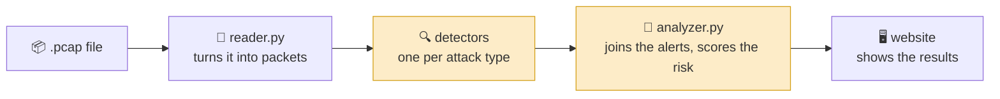
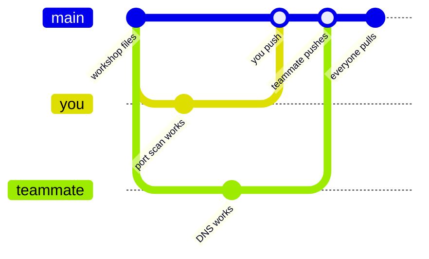

# 🛡️ Workshop 3 – PCAP File Analysis


*Build a tool that reads network traffic and finds the attacks hiding inside it.*

> 📘 **New here? Follow the [step-by-step Participant Guide](GUIDE.md).** It walks you through preparation, every step of the workshop, and solving the case.

---

## 🕵️ Scenario

You're a newly hired cybersecurity agent, called in after an attack on an organisation. The staff don't know much about online safety, and when you look around the drives, the files have been **encrypted**.

The only evidence left is a recording of the network traffic: a **packet capture (PCAP)**. Today you'll build **PCAP Sentinel**, a tool that digs through that recording and tells you **what** happened, **where**, **when** and **who** did it.

---

## 🎯 Learning objectives

| | Objective | Time |
|:-:|---|:-:|
| **LO1** | Build a tool that reads packet captures and detects threats | ~1 hr |
| **LO2** | Improve the tool as a team, sharing work with Git and GitHub | ~45 min |
| ⭐ | **Extra credit:** combine Workshop 1's reconnaissance tool with today's tool | – |

**By the end you'll be able to:**
- explain what a packet, a port and a PCAP file are
- spot the patterns behind port scans, password guessing, malware and website attacks
- turn a pattern into Python code that raises an alert
- work on one project with other people without overwriting each other's work

---

## 🧭 How it works



The 🟨 **yellow** parts are what you build. Everything else is ready-made and already works.

---

## 🧭 Choose your route

| | 🌐 **Browser route** *(recommended)* | 💻 **Own computer route** |
|---|---|---|
| **Best for** | Beginners, school or locked-down PCs | People comfortable with a terminal |
| **You need** | A GitHub account and a browser | A GitHub account and Python 3 |
| **You code in** | GitHub Codespaces (VS Code in your browser) | Your own editor (e.g. VS Code) |
| **Nothing to install?** | ✅ Yes | ❌ Python (and optionally Git) |

> Not sure? **Pick the browser route.** The code is the same either way.

---

## 🛠️ Part 1 – Set up *(≈ 15 min)*

### Step 1 · Create a GitHub account *(everyone)*

Sign up at [github.com/signup](https://github.com/signup).
> 💡 Use your **school email** to unlock the free [GitHub Student Developer Pack](https://education.github.com/pack).

### Step 2 · Make the group's copy *(one person, the organiser)*

1. On this repo, click **Fork** → **Create fork**. That copy is now your group's repo.
2. Open it → **Settings** → **Collaborators** → **Add people**, and invite each teammate.

**Teammates:** accept the invite (email or 🔔 on GitHub), then open the **organiser's** repo.

### Step 3 · Open the project

<table>
<tr><th>🌐 Browser route</th><th>💻 Own computer route</th></tr>
<tr valign="top"><td>

1. On the group's repo: green **Code** button → **Codespaces** → **Create codespace on main**.
2. Wait a minute. Everything installs itself.
3. In the terminal at the bottom, type:
   ```bash
   cd pcap-workshop
   python go.py
   ```

</td><td>

1. Install [Python 3](https://www.python.org/downloads/). On Windows, tick **"Add Python to PATH"**.
2. Get the repo: **Code** → **Download ZIP**, or clone it (see *Command line setup* below).
3. Open the `pcap-workshop` folder and double-click **`GO.bat`** (or type `python go.py`).

</td></tr>
</table>

**You should see** a scoreboard (every line says `--` for now), then the website opens. 🎉

### Step 4 · Pick a file *(everyone)*

Each person takes **one** file in `pcap-workshop/your_code/`. Decide as a group who does what.

| Who | File | What it catches | Difficulty |
|:-:|---|---|:-:|
| D1 | `detect_portscan.py` | 🚪 One machine knocking on lots of ports | ⭐ |
| D2 | `detect_bruteforce.py` | 🔑 Password guessing (logins and websites) | ⭐⭐⭐ |
| D3 | `detect_dns.py` | 🌐 Lookups for names that don't exist | ⭐⭐ |
| D4 | `detect_cleartext.py` | 👀 Passwords anyone can read | ⭐⭐ |
| D5 | `detect_ports.py` | 🦠 Traffic to known malware ports | ⭐ |
| D6 | `detect_web.py` | 🕸️ Website attacks (probing, SQL injection) | ⭐⭐⭐ |
| A | `analyzer.py` | 🧩 Joins everything into one report | ⭐⭐ |

> Fewer than 7 people? Start with D1, D2 and A, then pick up the rest. Working solo? Go in that order.

---

## 💻 Part 2 – Develop! *(≈ 1 hr, and leave some pizza for me 🍕)*

### Inside your file

Every file in `your_code/` looks like this:

| Section | What it tells you |
|---|---|
| **THE RULE** | Exactly what to detect, and when to raise an alert |
| **HINT** | A nudge towards the code |
| **TEST IT** | The command to run and the results to expect |
| **IDEAS** | Extra things to detect once your rule works ✨ |
| `# TODO` | Where your code goes |

Every detector follows the same pattern: **loop over the packets and take notes, then decide.**

### Test as you go

| I want to... | Type |
|---|---|
| Test **my** file | `python check.py portscan` *(or bruteforce, dns, cleartext, ports, web, analyzer)* |
| See the whole group's progress | `python check.py` |
| Open the website | `python start.py` → [127.0.0.1:8000](http://127.0.0.1:8000) |

```text
[OK] portscan    1 on attack-demo.pcap, 0 on compsoc-incident.pcap, none on the clean one
[--] dns         not started yet (returns no alerts)
[X ] cleartext   2 alert(s) on compsoc-incident.pcap, expected 1
```

`OK` = working · `--` = not started · `X` = needs fixing *(it tells you why)*

> 🌐 **In Codespaces:** when the website starts, click **Open in Browser** on the pop-up (or use the **Ports** tab).
> Click **Demo data** on the website to see made-up results before your code is ready.

### The evidence

| Capture | What's inside | A finished tool finds |
|---|---|:-:|
| `attack-demo.pcap` | A network under attack: scan, brute force, malware, DNS tricks | **8 alerts** · risk 100 |
| `compsoc-incident.pcap` | A website break-in: probing, password guessing, SQL injection | **4 alerts** · risk 68 |
| `clean-traffic.pcap` | Normal everyday traffic | **0 alerts** · risk 0 |

### ✅ Finished when

- [ ] `python check.py` shows **OK** on every line
- [ ] `attack-demo.pcap` on the website shows **8 alerts, risk score 100**
- [ ] `compsoc-incident.pcap` on the website shows **4 alerts, risk score 68**


### 🚀 Finished early?

- **Level up your file:** pick something from its **IDEAS** list.
- **Invent a detector:** copy `TEMPLATE_new_detector.py` to `detect_something.py`, then write your rule. It appears on the website automatically, and `python check.py something` tests it.
- **Restyle the website:** `web/index.html` is yours to make your own.
- **Check your work in Wireshark:** open a sample in [Wireshark](https://www.wireshark.org/) and find the attack yourself (see *Wireshark filters* below).

---

## 🔀 LO2 – Teamwork with Git *(≈ 45 min)*

Git keeps the history of every change, so the group can build one tool together.



Each person works on their own copy, then **pushes** it to GitHub. **Pulling** brings everyone's work back together.

> ✋ **Golden rule:** only edit **your own file**. If two people never change the same file, nobody's work gets overwritten.

| To... | 🌐 Codespaces | 🖥️ GitHub Desktop | 💻 Command line |
|---|---|---|---|
| **Get** everyone's work | Source Control → **Sync Changes** | **Fetch** → **Pull** | `git pull` |
| **Share** your work | Source Control → message → **Commit** → **Sync Changes** | Summary → **Commit** → **Push** | `git add your_code/detect_dns.py`<br>`git commit -m "DNS done"`<br>`git push` |

> 💡 Always **get** before you start and before you share.

**The join (0:35):** everyone shares their work, then one person gets everyone's work and runs `python check.py` for the whole group to see.

---

## 📚 FYI

<details>
<summary><b>📖 Jargon buster</b></summary>

<br>

| Word | Meaning |
|---|---|
| **Packet** | A small chunk of data sent across a network, like one envelope in a stream of post |
| **PCAP** | A recording of packets, made with a tool like Wireshark (*Packet CAPture*) |
| **IP address** | A computer's address on the network, e.g. `192.168.1.30` |
| **Port** | A numbered "door" on a computer. Each service has its own, e.g. 22 = SSH, 80 = websites |
| **SYN** | The first packet of a conversation: *"can we talk?"* |
| **DNS** | The internet's phone book: turns `example.com` into an IP address |
| **HTTP / HTTPS** | How websites are sent. HTTP is readable by anyone; HTTPS is encrypted |
| **Brute force** | Guessing passwords over and over until one works |
| **SQL injection** | Typing database commands into a form to trick a website |
| **Repo** | A project folder stored on GitHub |
| **Commit / Push / Pull** | Save a change / send it to GitHub / get everyone else's changes |

</details>

<details>
<summary><b>🦈 Wireshark filters to find the attacks yourself</b></summary>

<br>

| To see... | Type this in Wireshark's filter bar |
|---|---|
| Port scan knocks | `tcp.flags.syn == 1 && tcp.flags.ack == 0` |
| SSH login attempts | `tcp.dstport == 22 && tcp.flags.syn == 1` |
| Website logins | `http.request.method == "POST"` |
| Failed website logins | `http.response.code == 401` |
| Names that don't exist | `dns.flags.rcode == 3` |
| Cleartext passwords | `ftp.request.command == "PASS" \|\| http contains "password="` |
| Malware port traffic | `tcp.port == 4444` |

Right-click a packet → **Follow → TCP Stream** to read a whole conversation.

</details>

<details>
<summary><b>📁 What's in the folder</b></summary>

<br>

```text
pcap-workshop/
├── ready_made/      ⛔ don't edit: reads captures, runs the website, finds your detectors
├── your_code/       ✏️ the group's files (one each) + TEMPLATE_new_detector.py
├── web/             🎨 index.html: the web page, restyle it if you like
├── samples/         🧪 three test captures
├── check.py         ✅ tests everyone's work
├── start.py         🖥️ starts the website
└── go.py / GO.bat   🚀 install + test + open the website in one go
```

> Ignore `__init__.py`: it just tells Python the folder is a package.

</details>

<details>
<summary><b>🔧 Something's not working</b></summary>

<br>

| Problem | Fix |
|---|---|
| `python` not recognised | Try `py` instead, or reinstall Python with **"Add to PATH"** ticked |
| `No module named scapy` / `flask` | Run `python go.py`: it installs them |
| A warning about **libpcap** on Windows | Normal and harmless, ignore it |
| The website shows nothing new | Press **Ctrl + F5**, and check `python start.py` is still running |
| A "Detector crashed" row on the website | The detail says which file and line broke. Fix it and save |

Still stuck? A technical coordinator will help.

</details>

<details>
<summary><b>💻 Command line setup (Git + SSH key)</b></summary>

<br>

**1. Install Git and say who you are**
```powershell
git --version                      # prints a version if Git is installed
winget install --id Git.Git -e     # otherwise install it (or use git-scm.com/download/win)
git config --global user.name "Your Name"
git config --global user.email "you@example.com"
git config --global init.defaultBranch main
```

**2. Connect to GitHub with an SSH key**

A key has a **private** half (stays on your computer) and a **public** half (given to GitHub).
```powershell
ssh-keygen -t ed25519 -C "you@example.com"     # press Enter for the defaults
Get-Content $HOME\.ssh\id_ed25519.pub           # copy the line this prints
```
On GitHub: profile picture → **Settings** → **SSH and GPG keys** → **New SSH key** → paste → **Add SSH key**. Then test it:
```powershell
ssh -T git@github.com     # type "yes"; you should see "Hi your-username!"
```
> 🔒 Never share the private half (the file *without* `.pub`).

**3. Get the group's repo**
```powershell
git clone git@github.com:owner-name/Workshop-3---PCAP-file-analysis.git
cd Workshop-3---PCAP-file-analysis/pcap-workshop
python go.py
```

</details>

<details>
<summary><b>❓ What are Git and GitHub?</b></summary>

<br>

**Git** is a version control system: it records the full history of changes to your files, so nothing gets lost.
**GitHub** is a website built on Git. It stores projects online so lots of people can work on them at once.
**Codespaces** is GitHub's editor in the browser, so you can do all of this without installing anything.


</details>

---

### 🏷️ Project keywords

`automation` · `tool development` · `digital forensics` · `networks` · `threat detection` · `Wireshark` · `GitHub`
