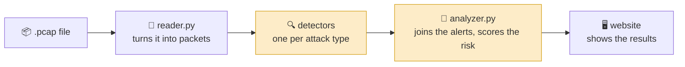

# 📘 Workshop 3 – Participant Guide

**Follow this guide from top to bottom.** Each step tells you what to do, why you're doing it, and what you should see.
You don't need any experience with Wireshark, networks or Git. Everything is explained as you go.

---

## 🗺️ The plan

| When | Part | What you'll do | Time |
|---|---|---|:-:|
| Before the day | **🎒 Preparation** | Make a GitHub account and choose your route | 10 min |
| Start | **🕵️ Briefing** | Understand the case and what a packet capture is | 5 min |
| | **🛠️ Part 1 – Set up** | Get the project running and pick your role | 15 min |
| | **💻 Part 2 – Develop** | Build your detector and test it | 60 min |
| 0:35 into Part 2 | **🔀 The join** | Combine everyone's work | – |
| | **🔎 Part 3 – Investigate and improve** | Solve the case, then make the tool better together | 45 min |
| End | **🏁 Wrap-up** | Share what you found | 5 min |

---

## 🎒 Preparation (before the session)

Do this before the workshop so you can start straight away.

### ✅ Everyone

- [ ] **Make a GitHub account** at [github.com/signup](https://github.com/signup).
  > 💡 Use your **school email**. It unlocks the free [GitHub Student Developer Pack](https://education.github.com/pack), which includes extra Codespaces hours.
- [ ] **Choose your route:**

| | 🌐 Browser route *(recommended)* | 💻 Own computer route |
|---|---|---|
| **Pick this if...** | You're new to coding, or on a school or locked-down PC | You're comfortable with a terminal |
| **What to prepare** | Nothing else! | Install [Python 3](https://www.python.org/downloads/). On Windows, tick **"Add Python to PATH"** |

- [ ] *(Optional, but great for later)* Install [Wireshark](https://www.wireshark.org/download.html) to look inside captures yourself.

### ✅ The organiser *(one person per group)*

Pick one person to look after the group's copy of the project.

- [ ] Open the workshop repo on GitHub and click **Fork** → **Create fork**. This is now your **group's repo**.
- [ ] In your fork: **Settings** → **Collaborators** → **Add people**, and invite each teammate by their GitHub username.

> 👥 **Teammates:** accept the invite from your email or the 🔔 on GitHub. From now on, always use the **organiser's** repo, not the original.

---

## 🕵️ Briefing: the case

> You're a newly hired cybersecurity agent, called in after an attack on an organisation. The staff don't know much about online safety, and when you look around the drives, the files have been **encrypted**.
>
> The only evidence left is a recording of the network traffic. Your job: build a tool that finds out **what** happened, **where**, **when** and **who** did it.

### 📦 What is a packet capture?

Everything a computer sends over a network is chopped into small pieces called **packets**, like envelopes in the post. Each packet has:

| Part | Like an envelope's... | Example |
|---|---|---|
| **Source IP** (`src`) | sender's address | `203.0.113.66` |
| **Destination IP** (`dst`) | recipient's address | `198.51.100.20` |
| **Port** (`dport`) | flat number: which service it's for | `22` = SSH, `80` = website |
| **Payload** | letter inside | `GET /admin/ HTTP/1.1` |

A **packet capture** (`.pcap` file) is a recording of thousands of these packets. Investigators open them in **Wireshark** and look for patterns. Today you'll teach Python to spot those patterns **automatically**.

### 🧭 How the tool works



The 🟨 **yellow** parts are what your group builds. Everything else is ready-made.

---

## 🛠️ Part 1 – Set up

### 📂 Step 1 · Know what's in the project

The `pcap-workshop` folder contains:

```text
pcap-workshop/
├── ready_made/      ⛔ already working: reads captures and runs the website (nobody edits these)
├── your_code/       ✏️ the detectors + analyzer: one file per person
├── web/             🎨 index.html: the web page (restyle it if you like)
├── samples/         🧪 three test captures (the evidence)
├── check.py         ✅ tests everyone's work
├── start.py         🖥️ starts the website
└── go.py / GO.bat   🚀 install + test + open the website in one go
```

`your_code/` is where you work. Ignore `__init__.py`: it just tells Python the folder is a package.

### 🚀 Step 2 · Open the project

<table>
<tr><th>🌐 Browser route</th><th>💻 Own computer route</th></tr>
<tr valign="top"><td>

1. Open your **group's** repo on GitHub.
2. Green **Code** button → **Codespaces** tab → **Create codespace on main**.
3. Wait a minute while VS Code loads in your browser.
4. Click into the **terminal** at the bottom and type:
   ```bash
   cd pcap-workshop
   python go.py
   ```

> 💡 **Coming back later?** Reopen the same codespace from [github.com/codespaces](https://github.com/codespaces). Don't create a new one.

</td><td>

1. Open your **group's** repo on GitHub.
2. Green **Code** button → **Download ZIP**, and unzip it.
   *(Using Git? See **Command line setup** under Help at the bottom.)*
3. Open the `pcap-workshop` folder.
4. Double-click **`GO.bat`**.
   *(Mac/Linux: open a terminal in the folder and type `python3 go.py`.)*

</td></tr>
</table>

### 👀 What you should see

```text
[OK] scapy and flask are installed.

Checking everyone's work...

[--] portscan    not started yet (returns no alerts)
[--] bruteforce  not started yet (returns no alerts)
...
Start the website now? [Y/n]
```

Press **Enter** and the website opens. Click **Demo data** to see what a finished tool shows. 🎉

> ❗ Something went wrong? See **🆘 Help** at the bottom of this guide.

### 👥 Step 3 · Pick your role

Each person takes **one** file. Decide together. If two people edit the same file, their work clashes.

| Who | File | What it catches | Difficulty |
|:-:|---|---|:-:|
| D1 | `detect_portscan.py` | 🚪 One machine knocking on lots of ports | ⭐ |
| D2 | `detect_bruteforce.py` | 🔑 Password guessing (logins and websites) | ⭐⭐⭐ |
| D3 | `detect_dns.py` | 🌐 Lookups for names that don't exist | ⭐⭐ |
| D4 | `detect_cleartext.py` | 👀 Passwords anyone can read | ⭐⭐ |
| D5 | `detect_ports.py` | 🦠 Traffic to known malware ports | ⭐ |
| D6 | `detect_web.py` | 🕸️ Website attacks (probing, SQL injection) | ⭐⭐⭐ |
| A | `analyzer.py` | 🧩 Joins everything into one report | ⭐⭐ |

> **Fewer than 7 people?** Start with D1, D2 and A, then share out the rest. **Working solo?** Go in that order.

---

## 💻 Part 2 – Develop

*Get developing... and leave some pizza for me 🍕*

### 📖 Step 4 · Read your file

Open your file in `your_code/`. **Read the top part before writing anything.** It's your brief:

| Section | What it tells you |
|---|---|
| **THE RULE** | Exactly what to detect, and when to raise an alert |
| **HINT** | A nudge towards the code |
| **EACH ALERT LOOKS LIKE THIS** | The exact shape your alerts must have |
| **TEST IT ON ITS OWN** | The command to run, and how many alerts to expect |
| **IDEAS** | Extra things to detect once your rule works ✨ |
| `# TODO` | Where your code goes |

### 📦 Step 5 · Meet a packet

Your `detect(packets)` function receives a **list of packets**. Each packet is a Python dictionary like this one, taken from the incident capture:

```python
{"time": 1.368,                  # seconds into the capture
 "src": "203.0.113.11",          # who sent it
 "dst": "198.51.100.20",         # who it's for
 "proto": "TCP",                 # "TCP", "UDP" or "OTHER"
 "sport": 40002, "dport": 80,    # sender's port, receiver's port (80 = website)
 "flags": "PA",                  # TCP flags: "S" = "can we talk?"
 "payload": b"GET / HTTP/1.1 ...",   # the data inside (bytes)
 "dns_query": None, "dns_rcode": None}   # filled in for DNS packets only
```

You read a value with square brackets, for example `p["src"]` or `p["dport"]`.

### 🧠 Step 6 · Learn the pattern

**Every detector works the same way: take notes, then decide.** Here's a worked example that *isn't* one of the tasks. It finds computers that sent more than 500 packets:

```python
def detect(packets):
    alerts = []

    # 1. TAKE NOTES: loop over every packet and count per sender
    counts = {}
    for p in packets:
        counts[p["src"]] = counts.get(p["src"], 0) + 1

    # 2. DECIDE: go through the notes and raise an alert when over the limit
    for src, n in counts.items():
        if n > 500:
            alerts.append({
                "detector": "chatty",
                "severity": "low",
                "title": "Very chatty computer",
                "src": src,
                "dst": "",
                "detail": f"{src} sent {n} packets",
            })

    return alerts
```

On `attack-demo.pcap` this flags exactly one computer, `10.0.0.66`: the attacker! On the clean capture it flags nobody.

Your rule will use different notes. Sometimes a **set** (to count *different* things) or a **list of times** works better than a count, but the shape stays the same.

### ✍️ Step 7 · Write your code

Replace the `# TODO` with your code. Work in small steps:

1. Write the **loop** and `print()` a few packets that match your rule to check you're catching the right ones.
2. Add the **notes** (a dict).
3. Add the **decision** and build the alert.
4. Remove your `print()`s.

### ✅ Step 8 · Test it

Save your file, then run your file's test:

```bash
python check.py portscan
```

*(Use your own file's name: `bruteforce`, `dns`, `cleartext`, `ports`, `web` or `analyzer`.)*

| You see | It means | Do this |
|:-:|---|---|
| `OK` | 🎉 Your detector works | Share it (Step 9), then try an **IDEA** from your file |
| `--` | Not started: no alerts yet | Keep going! Check your loop finds anything with `print()` |
| `X` | Needs fixing | Read the message: it tells you what's wrong |

**Common `X` messages:**

| Message | Usually means |
|---|---|
| `crashed: KeyError: 'xyz'` | A typo in a key name, e.g. `p["dst_port"]` instead of `p["dport"]` |
| `alert is missing key(s)` | Your alert dict is missing one of the six keys |
| `alert(s) on the CLEAN sample` | Your rule is too loose: it's catching normal traffic |
| `300 alert(s) on attack-demo.pcap, expected 1` | You're making one alert per **packet** instead of one per **pair** |

### 🔀 Step 9 · Share your work

As soon as you get an `OK`, share it so the group has it. **Share early, share often.**

> ✋ **Golden rule:** only edit **your own file**. If two people never change the same file, nobody's work gets overwritten.

| To... | 🌐 Codespaces | 💻 Command line |
|---|---|---|
| **Share** your work | Source Control icon (left sidebar) → type a message → **Commit** → **Sync Changes** | `git add your_code/detect_dns.py`<br>`git commit -m "DNS detector working"`<br>`git push` |
| **Get** everyone's work | Source Control → **Sync Changes** | `git pull` |

> 💡 Always **get** before you start and before you share.

### 🧩 Step 10 · The join

**35 minutes into Part 2**, the whole group comes together:

1. Everyone **shares** their latest work, even if it isn't finished.
2. One person **gets** everyone's work and runs `python check.py` on a shared screen.
3. Run `python start.py`, upload **`samples/attack-demo.pcap`** and look at the results together.
4. Anyone with `X` or `--`: the group helps fix it. Then share again.

**🏆 Part 2 is finished when:**
- [ ] `python check.py` shows **OK** on every line
- [ ] `attack-demo.pcap` on the website shows **8 alerts, risk score 100**
- [ ] `compsoc-incident.pcap` on the website shows **4 alerts, risk score 68**

---

## 🔎 Part 3 – Investigate and improve (LO2)

Your tool works. Now use it like a real investigator, and keep improving it as a team using Git.

### 🕵️ Step 11 · Solve the case

Upload **`samples/compsoc-incident.pcap`** to your website. This is the recording from the attacked organisation's web server. As a group, answer:

| # | Question | Hint |
|:-:|---|---|
| 1 | **Who** is the attacker? (IP address) | Which `src` appears in every alert? |
| 2 | **Where**: which computer and which page were attacked? | Look at `dst` and the alert details |
| 3 | **What** did the attacker do first, before trying to log in? | One alert is about looking for hidden pages |
| 4 | How many passwords did they guess, and did any work? | The brute-force alert |
| 5 | How did they **finally get in**? | The highest-risk alert |
| 6 | **Why** could anyone on the network have seen the passwords? | The cleartext alert |
| 7 | What should the organisation fix first? | Think about each alert's cause |

> 🦈 **Got Wireshark?** Open the same file and prove it: type `http.request.method == "POST"` in the filter bar, right-click a packet → **Follow → HTTP Stream**, and read what the attacker typed.

### ✨ Step 12 · Improve the tool together

Pick one or more, and **share each improvement with Git** (Step 9) as you go:

| Idea | How |
|---|---|
| ⬆️ **Level up your detector** | Pick something from the **IDEAS** list at the top of your file |
| 🆕 **Invent a new detector** | Copy `TEMPLATE_new_detector.py` to `detect_something.py`. It appears on the website automatically. Test it with `python check.py something` |
| 🎨 **Restyle the website** | Edit `web/index.html` and refresh the page |
| 🔁 **Review a teammate's code** | Get their latest work, read their file and suggest one improvement |

---

## 🏁 Wrap-up

Each group shares:
1. 🕵️ **The story of the attack** in four sentences: who, where, what, how.
2. 🛠️ **One thing you added** to the tool in Part 3.
3. 💡 **One thing you'd tell the organisation** to stop this happening again.

**⭐ Extra credit:** combine **Workshop 1's reconnaissance tool** with today's tool to make one multipurpose tool.

---

## 🆘 Help

### 🔧 Something's not working

| Problem | Fix |
|---|---|
| `python` is not recognised | Try `py` instead, or reinstall Python with **"Add to PATH"** ticked |
| `No module named scapy` / `flask` | Run `python go.py`: it installs them |
| A warning about **libpcap** on Windows | Normal and harmless, ignore it |
| The website shows nothing new | Press **Ctrl + F5**, and check `python start.py` is still running |
| A **"Detector crashed"** row on the website | The detail says which file and line broke. Fix it and save |
| Git says there's a **conflict** | Someone else edited your file. Ask a coordinator |

Still stuck? Put your hand up: a technical coordinator will help.

### 💻 Command line setup

Only needed if you're on the own computer route **and** want to use Git from the terminal.

**1. Install Git and tell it who you are**
```powershell
git --version                      # prints a version if Git is installed
winget install --id Git.Git -e     # otherwise install it (or use git-scm.com/download/win)
git config --global user.name "Your Name"
git config --global user.email "you@example.com"
git config --global init.defaultBranch main
```

**2. Connect your computer to GitHub with an SSH key**

GitHub needs proof that a push really came from you. A key has two halves: a **private** half that stays on your computer, and a **public** half you give to GitHub.
```powershell
ssh-keygen -t ed25519 -C "you@example.com"     # press Enter to accept the defaults
Get-Content $HOME\.ssh\id_ed25519.pub           # copy the whole line this prints
```
On GitHub: profile picture → **Settings** → **SSH and GPG keys** → **New SSH key** → give it a name → paste → **Add SSH key**. Then test it:
```powershell
ssh -T git@github.com     # type "yes"; you should see "Hi your-username!"
```
> 🔒 Never share the private half (the file *without* `.pub`).

**3. Get your group's repo**
```powershell
git clone git@github.com:organiser-name/Workshop-3---PCAP-file-analysis.git
cd Workshop-3---PCAP-file-analysis/pcap-workshop
python go.py
```

### 📖 Jargon buster

| Word | Meaning |
|---|---|
| **Packet** | A small chunk of data sent across a network |
| **PCAP** | A recording of packets (*Packet CAPture*) |
| **IP address** | A computer's address on the network, e.g. `192.168.1.30` |
| **Port** | A numbered "door" for one service, e.g. 22 = SSH, 80 = websites |
| **SYN** | The first packet of a conversation: *"can we talk?"* |
| **DNS** | The internet's phone book: turns names into IP addresses |
| **HTTP / HTTPS** | How websites are sent. HTTP can be read by anyone; HTTPS is encrypted |
| **Brute force** | Guessing passwords over and over until one works |
| **SQL injection** | Typing database commands into a form to trick a website |
| **Repo** | A project folder stored on GitHub |
| **Commit / Push / Pull** | Save a change / send it to GitHub / get everyone else's changes |

### ❓ What are Git and GitHub?

**Git** is a version control system: it records the full history of changes to your files, so nothing gets lost.
**GitHub** is a website built on Git. It stores projects online so lots of people can work on the same project at once without overwriting each other's work.


